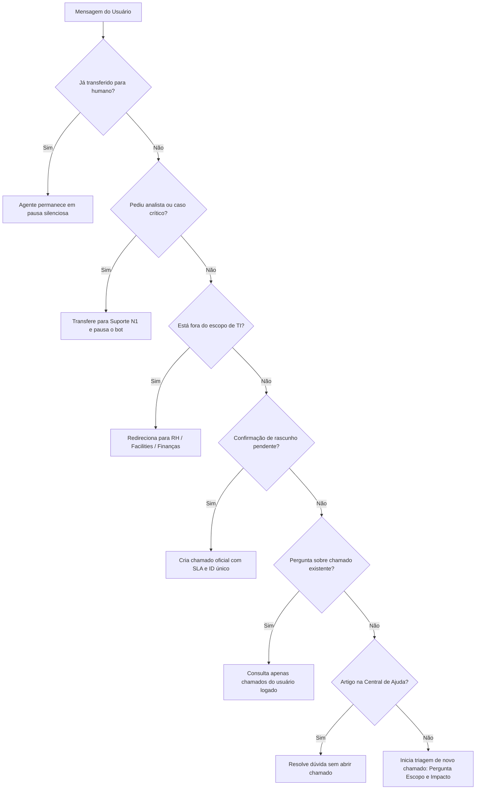

# 🤖 Nexo Assist — Agent do Service Desk de TI

> **Desafio Técnico:** Nexo Assist, o agent do service desk de TI  
> **Processo Seletivo:** Beyond the Bytes

---

## 📌 1. Visão Geral do Projeto

A **Nexo** conta com cerca de 2.000 colaboradores. Tradicionalmente, solicitações e incidentes eram abertos via formulários estáticos, resultando em chamados duplicados, prioridades incoerentes, ausência de dados cruciais e sobrecarga dos analistas com triagens manuais.

O **Nexo Assist** é uma solução inteligente de Service Desk baseada em **Agent conversacional** que:

1. **Resolve dúvidas e consultas sem fila:** Busca na Central de Ajuda e responde no próprio chat.
2. **Abre chamados bem estruturados:** Classifica Tipo (`INC` ou `REQ`), Categoria, Impacto, Prioridade e SLA, prevenindo duplicidades e exigindo confirmação do colaborador.
3. **Encaminha ao analista no momento certo:** Transfere atendimentos críticos, chamados com SLA estourado ou dúvidas com baixa confiança da IA, pausando o bot e entregando histórico completo ao suporte humano.
4. **Oferece transparência total:** Cada resposta do agente explicita o que foi analisado, a regra de negócio aplicada e o grau de confiança.

---

## 🏛️ 2. Arquitetura da Solução

O projeto foi arquitetado em camadas desacopladas seguindo os princípios de responsabilidade única e Clean Architecture:

```
┌─────────────────────────────────────────────────────────────┐
│                    CAMADA DE INTERFACE                      │
│   • Tela 1: Login com Seletor de Perfis (Colaborador / N1) │
│   • Telas 2 e 3: Chat do Colaborador + Painel Decisões IA  │
│   • Telas 4 e 5: Console do Analista (Pixel-Perfect Pen.dev)│
└──────────────┬───────────────────────────────┬──────────────┘
               │                               │
               ▼                               ▼
┌─────────────────────────────┐ ┌─────────────────────────────┐
│      AGENTE INTELIGENTE     │ │    CONSOLE DE OPERAÇÕES     │
│       (AgentService)        │ │   (ConversationService)     │
│ • Motor de Triagem & Rgras  │ │ • Gestão de Fila & Status   │
│ • Classificador de SLA/Risco│ │ • Transbordo Bot <-> Humano │
│ • Transparência de Decisão  │ │ • Intervenção em Tempo Real │
└──────────────┬──────────────┘ └──────────────┬──────────────┘
               │                               │
               └───────────────┬───────────────┘
                               │
                               ▼
┌─────────────────────────────────────────────────────────────┐
│              CAMADA DE SERVIÇOS & DADOS SIMULADOS           │
│ • TicketService: CRUD e cálculo de SLA (Separado do Agent)  │
│ • KnowledgeBaseService: Motor de busca na base de artigos   │
│ • Persistência: LocalStorage (sobrevive a reinício da app)  │
└─────────────────────────────────────────────────────────────┘
```

### 🧱 Separação de Responsabilidades:

- **`src/services/agentService.ts`**: Cérebro do agente. Implementa as regras de triagem do Anexo A, cálculo de SLA e gera logs estruturados de auditoria/raciocínio.
- **`src/services/ticketService.ts`**: Serviço de chamados legado independente, responsável pelo ciclo de vida dos tickets (`INC` e `REQ`).
- **`src/services/conversationService.ts`**: Gerencia a fila de atendimento do analista, alternando os estados da conversa (`com_agente`, `aguardando_analista`, `em_atendimento`, `encerrada`).
- **`src/components/DecisionTransparency.tsx`**: Painel visual de explicabilidade da IA exibido acima de cada resposta.
- **`src/pages/Atendente.tsx`**: Console operacional do analista N1/N2 em 3 colunas (Fila categorizada, Chat e Chamados do Usuário).

---

## 🧠 3. Como o Agente Decide o que Fazer (Regras de Decisão)

O agente avalia a mensagem do colaborador e o contexto da sessão passando por um pipeline sequencial de regras estritas baseadas no **Anexo A**:



### 📐 Matriz de Prioridade e SLA Implementada:

Conforme definido no Anexo A do PRD:
| Impacto & Urgência | Prioridade | Prazo de Resposta | Comportamento no Sistema |
| :--- | :---: | :---: | :--- |
| **Parado para equipe ou empresa** | **Crítica** | **1 hora** | Plantão 24h, transbordo sugerido imediato. |
| **Impede de trabalhar ou reunião no dia** | **Alta** | **4 horas úteis** | Priorizado na fila do analista. |
| **Atrapalha, mas possui alternativa** | **Média** | **3 dias úteis** | Alerta visual caso fique mais de 3 dias sem resposta. |
| **Melhoria ou dúvida sem urgência** | **Baixa** | **5 dias úteis** | Atendimento assíncrono padrão. |

### 🛡️ Prevenção de Duplicidade:

Antes de abrir qualquer chamado, o agente consulta os tickets em aberto do colaborador. Se identificar um ticket do mesmo tema (ex: erro na VPN), ele **rejeita a duplicidade** e oferece adicionar uma nova informação/complemento ao chamado existente.

---

## 🔍 4. Transparência das Decisões (Explainable AI)

A transparência é o critério mais valorizado no desafio. Em cada interação, o agente emite um bloco auditável com:

- **Ação Executada:** (ex: `consultou seus chamados`, `classificou a prioridade`, `buscou na central de ajuda`).
- **Nível de Confiança:** Grau percentual (ex: `95%` ou `41%`). Quando a confiança cai, o console do analista recebe uma tag explícita (`Agent pediu ajuda · confiança 41%`).
- **Raciocínio & Regra Aplicada:** Explicação textual de por que aquela decisão foi tomada em conformidade com as políticas do Service Desk.

---

## 👥 5. Jornada de Usuários e Histórias Atendidas

### 👤 Como Funcionário da Nexo:

1. **Tirar dúvidas sem abrir chamado:** Respostas diretas para dúvidas sobre e-mail no celular, horários de TI e Wi-Fi via Central de Ajuda.
2. **Consultar chamados sem lembrar o número:** Comando simples _"Meus chamados"_ lista todos os tickets com aviso de prazos vencidos.
3. **Evitar duplicidade e complementar chamado:** O bot sugere complementar chamados abertos em vez de criar um novo.
4. **Conferir dados antes da abertura:** Apresenta card de rascunho com Tipo, Categoria, Prioridade e SLA antes de registrar.
5. **Falar com analista:** A qualquer momento, solicitando pelo chat ou em problemas de gravidade crítica.
6. **Retomar de onde parou:** Estado salvo no `localStorage`, persistindo mensagens e rascunhos.

### 👨‍💻 Como Analista do Service Desk (N1/N2):

1. **Chamados bem especificados:** Recebe tickets já categorizados e com o escopo identificado, eliminando o retrabalho.
2. **Fila com visibilidade dos casos de baixa segurança:** Filtros por abas (_Para você_, _Com o agent_, _Minhas_) com badges de chamados transferidos e de baixa confiança.
3. **Controle total do atendimento:** Botão **"Assumir atendimento"** (que pausa o bot), chat em tempo real e opção **"Devolver ao agent"** ou **"Encerrar"**.
4. **Histórico lateral:** Acesso instantâneo a todos os chamados abertos e encerrados do usuário com visualização de atrasos.

---

## ⚖️ 6. Trade-offs e Escolhas Técnicas

1. **Simulação Local vs LLM em Nuvem:**
   - _Decisão:_ Implementamos o motor de regras e triagem com TypeScript determinístico estrito integrado a dados locais.
   - _Motivo:_ Resposta instantânea (<10ms), custo zero de API por conversa, 100% de previsibilidade nas regras do Anexo A e proteção total dos dados corporativos (sem envio de dados para provedores externos).
   - _Extensibilidade:_ A arquitetura do `AgentService` está preparada para receber modelos via Mastra ou LangGraph.js bastando plugar a API externa no método `processMessage`.
2. **Persistência em LocalStorage com Isolamento:**
   - _Decisão:_ Os chamados e conversas são salvos no armazenamento local simulando um banco de dados.
   - _Motivo:_ Permite testar o desligamento e reabertura da aplicação sem a necessidade de configurar um banco relacional externo (Docker/PostgreSQL), atendendo com agilidade o requisito de rodar com poucos comandos.

---

## 🔮 7. O que faríamos com mais tempo

- **Integração com LLM via Mastra/LangGraph:** Conectar a pipelines de embeddings vetoriais (RAG) para busca semântica em artigos PDF complexos.
- **WebSocket em tempo real:** Substituir o barramento local de eventos por WebSockets (Socket.io) para comunicação síncrona entre navegadores diferentes.
- **Testes Automatizados:** Implementar testes unitários com Vitest cobrindo 100% das combinações da matriz de SLA.
- **Análise de Sentimento do Usuário:** Indicador visual de irritabilidade do colaborador para priorização automática na fila.

---

## 🚀 8. Instruções de Execução

### Pré-requisitos:

- Node.js (versão 18 ou superior)
- Gerenciador de pacotes `npm`

### Passo a Passo:

1. **Clone o repositório:**

   ```bash
   git clone https://github.com/Paulo-Borges/desafioNexo.git
   cd desafioNexo
   ```

2. **Instale as dependências:**

   ```bash
   npm install
   ```

3. **Inicie o servidor de desenvolvimento:**

   ```bash
   npm run dev
   ```

4. **Acesse no seu navegador:**
   - Abra [http://localhost:5173](http://localhost:5173)

---

## 🧪 9. Roteiro Sugerido de Testes

1. **Tela de Login (`/`):**
   - Utilize o **Seletor de Perfis** na tela de login para alternar rapidamente entre o perfil de **Colaborador** (vai para `/chat`) e de **Analista** (vai para `/atendente`).
2. **Testando Autoatendimento:**
   - Digite: _"Como configurar o e-mail no celular?"_ -> O agente responde com o artigo da Central sem abrir ticket.
3. **Testando Abertura de Chamado & SLA:**
   - Digite: _"Erro 809 na VPN"_ -> O agente pergunta o impacto (_Só eu_, _Minha equipe_, _Toda a empresa_), calcula a prioridade e gera o rascunho para confirmação.
4. **Testando Prevenção de Duplicidade:**
   - Tente relatar o mesmo erro de VPN novamente -> O bot avisa que já existe o ticket e oferece adicionar complemento.
5. **Testando Console do Analista (`/atendente`):**
   - Veja a fila com abas (_Para você_, _Com o agent_, _Minhas_), clique na conversa da Ana Souza, clique em **Assumir Atendimento**, converse pelo chat e visualize o painel lateral com histórico de chamados.
